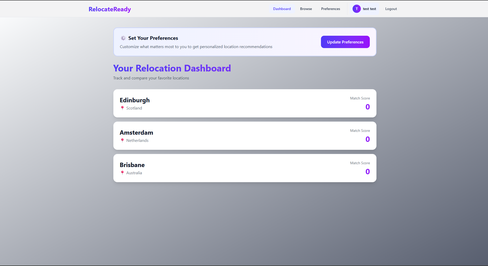
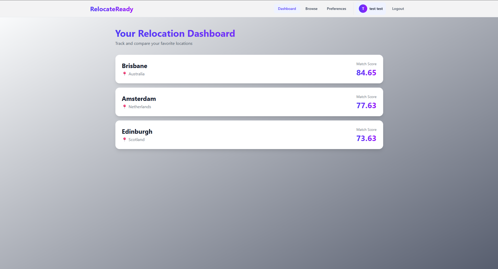

# RelocateReady: Frontend

RelocateReady helps people compare cities they're considering moving to. Users weight what matters most to them (cost of living, safety, climate, healthcare), save the cities they're interested in, and get a personalized ranking.

This repository is the **frontend**: a Next.js app that talks to a FastAPI backend.

**Live demo:** https://relocate-ready.vercel.app  ·  **Backend repo (API, security, architecture):** https://github.com/Jonathan-Jordan22/RelocateReady

> The API runs on free-tier hosting. If it has been idle, the first load can take up to a minute while the server wakes up, and the app shows a message while it waits.





## Features

- **Browse cities** with descriptions and cost, safety, climate, and healthcare scores
- **Personal preferences**: set how much each factor matters to you
- **Dashboard** that ranks your saved cities by how well they match your preferences
- **Account management**: sign up, log in, update your profile, or delete your account
- **Live password checklist** on signup that shows each requirement turning green as it's met, with accessible labels for screen readers
- **Clear error messages** that surface the API's validation errors instead of a generic failure

## How It Works

- **Authentication:** logging in returns a JWT, which the app stores and sends as an `Authorization: Bearer` header on every protected request. All of this goes through a single helper, `apiFetch` in `app/lib/api.ts`, so no page builds auth headers by hand. If the API rejects a token because it expired or was tampered with, the helper logs the user out and redirects to the login page.
- **Configuration:** the API base URL comes from the `NEXT_PUBLIC_API_URL` environment variable, so switching between the local and production backends requires no code changes.
- **Cold starts:** the homepage sends a lightweight request to wake the backend as soon as a visitor arrives, and slow loads show an explanation instead of a frozen spinner.

For the security design behind the API, including the access-control vulnerability that motivated the token-based auth, see the [backend README](https://github.com/Jonathan-Jordan22/RelocateReady#security).

## Tech Stack

| Area | Technology |
|---|---|
| Framework | Next.js 16 (App Router), React 19 |
| Language | TypeScript |
| Styling | Tailwind CSS v4 |
| Hosting | Vercel |
| Backend | FastAPI + PostgreSQL ([separate repo](https://github.com/Jonathan-Jordan22/RelocateReady)) |

## Running Locally

**Prerequisites:** Node.js 20.9+ and a running copy of the [backend](https://github.com/Jonathan-Jordan22/RelocateReady#running-locally).

```bash
# 1. Clone and install dependencies
git clone https://github.com/Jonathan-Jordan22/RelocateReady-Frontend.git
cd RelocateReady-Frontend
npm install

# 2. Point the app at your local backend
echo "NEXT_PUBLIC_API_URL=http://127.0.0.1:8000" > .env.local

# 3. Start the dev server
npm run dev
```

Open http://localhost:3000. On Windows, create `.env.local` in VS Code instead of using `echo`, so the file is saved as UTF-8.

### Environment Variables

| Variable | Description |
|---|---|
| `NEXT_PUBLIC_API_URL` | Base URL of the backend API, with no trailing slash. Use `http://127.0.0.1:8000` locally and the Render URL in production. |

Variables prefixed with `NEXT_PUBLIC_` are embedded in the JavaScript sent to the browser, so this app never stores secrets in them.

### Scripts

| Command | Description |
|---|---|
| `npm run dev` | Start the development server |
| `npm run build` | Create a production build (also runs the full TypeScript check) |
| `npm run start` | Serve the production build |
| `npm run lint` | Run ESLint |

## Project Structure

```
app/
├── components/
│   └── NavBar.tsx      # Navigation, login state, logout
├── lib/
│   └── api.ts          # API base URL, token storage, and apiFetch helper
├── browse/             # Browse and save cities
├── dashboard/          # Ranked saved cities
├── preferences/        # Set importance weights
├── settings/           # Profile and account deletion
├── login/
├── signup/             # Includes the live password checklist
├── layout.tsx
└── page.tsx            # Homepage (also warms up the backend)
```

## Roadmap

- [ ] Move authentication from localStorage to httpOnly cookies
- [ ] Side-by-side city comparison view
- [ ] Automated component and end-to-end tests

## Author

**Jonathan Jordan**, B.S. Secure Software Development
GitHub: [@Jonathan-Jordan22](https://github.com/Jonathan-Jordan22)
